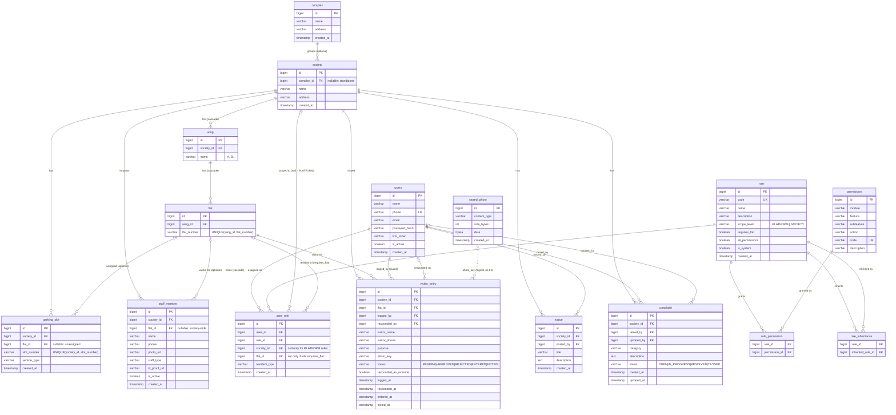

# ER Diagram

Generated from the JPA entities and the Flyway migrations (`V1`–`V7`). `notice` and `complaint` exist in
the schema (V1) but have no JPA entity yet.

## How the pieces fit

- **Property hierarchy:** `complex` (optional) → `society` → `wing` → `flat`. Deleting a society cascades
  to its wings and flats; deleting a wing cascades to its flats.
- **Identity vs. authorization:** `users` is identity only. Everything a user can do lives in
  `user_role`: one row per (user, role, society, flat) scope. A user can be a resident in one society
  and a committee member in another.
- **Dynamic RBAC:** `role` ↔ `permission` is many-to-many through `role_permission`. `role_inheritance`
  is a self-referencing many-to-many on `role`, so a higher role picks up the permissions of the roles it
  inherits. `all_permissions = true` (SUPER_ADMIN) grants everything.
- **Visitors:** a `visitor_entry` belongs to a flat (and its society). It references two users: the guard
  who logged it (`logged_by`) and the resident or overriding authority who answered (`responded_by`).
  `photo_key` holds a `stored_photo.id` as a string, with no foreign key.
- **Phase 2 tables:** `parking_slot` and `staff_member` have their schema and entities, but no workflow
  yet. `notice` and `complaint` are schema-only.
